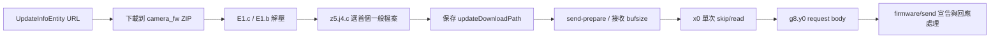

# LUMIX Lab 3.1.0 第一階段：DEX、JNI、更新資料流與反編譯錯誤

日期：2026-10-15（Asia/Taipei）。本輪依使用者要求以 **S5M2 韌體研究為背景**，只執行前置確認及 A／B／C；沒有展開 D 的完整通訊狀態機或 E 的新官方資料調查。S1M2／S5 的地址、處理函式和架構沒有移植到 S5M2。

## 五個審查問題

1. **新增了什麼？**【已驗證】完整讀取兩個 DEX 的 76,901 個方法定義；取得 214 個 native 宣告、12 個 System 載入呼叫位置，以及 Java／JNI／ELF 對照。證實 FFmpeg 的 15 項動態 JNI 註冊靜態路徑。用 Ghidra 分析四個庫中的 52 個選定函式，逐條核對 8,154 條指令位元組。恢復 24 個失敗方法的原始指令與結構 CFG，並新增更新檔選擇、長度來源及單次讀取的資料流證據。
2. **修正了哪些舊結論？**【已驗證】歷史「42 個失敗方法」應改為 **42 個錯誤事件、24 個不同方法**。另發現 `E1.b` 的預設 JADX Java 把父目錄條件組合錯誤；原 DEX 在父目錄有效時會呼叫 `createNewFile()`。舊「讀取分片後直接傳送」須補上單次 `skip/read` 回傳長度未檢查的界線。
3. **JNI 有可驗證的韌體處理入口嗎？**【尚未確認】本輪追蹤的 ZIP→檔案→byte[]→HTTP request body 路徑沒有建立通往 JNI 的韌體位元組資料流。已找到的動態表屬於 `FFmpegMediaMetadataRetriever`，不能把它稱為韌體解碼器。這不是對反射、計算式呼叫、平台原生碼或整個 App 的不存在證明。
4. **Android 端仍有未追蹤部分嗎？**【已驗證】所有可見 `firmware/*` API 宣告和 `UpdateInfoEntity` 路徑讀寫位置都已索引；但快取／資料庫合併、部分合成 callback 的所有上下文，以及 request body 後方具體 HTTP sink 的所有分派尚未逐支線證明。【尚未確認】沒有證實額外的韌體解密／驗簽路徑，也不能宣稱所有可能路徑已關閉。
5. **最值得研究的三條鏈？** `F5/f.c`／`d7/a.apply`／`z5/g4.run` 的快取與路徑生命週期；`FirmwareUpdateDetailFragment.x0`→`g8/y0.c`→具體 HTTP sink 的位元組與例外邊界；S5M2 真正接收端→檔案→認證／解碼→載入鏈。第三條仍缺同機型實作，不能替它虛構函式名稱或地址。

## 輸入與可用性

【已驗證】原始 APK／DEX／SO 共 25 個輸入在前置階段及分析後核對大小與完整 SHA-256；與前階段相同。原檔保持只讀，沒有執行 App、DEX、SO 或固件。來源與完整摘要見 [inputs.json](results/inputs.json)。

| 類別 | 本機實際取得 | GitHub 公開／歷史／缺口 |
|---|---|---|
| Lab 3.1.0、versionCode 22 | 5 個 Google Play 配置 APK、2 個 DEX、18 個 ARM64 SO | 原二進位不分發；歷史 delivery manifest 的身分已匹配，未重新建立發行者簽章信任鏈 |
| 既有分析 | 舊 JADX 輸出、分析報告與本輪新輸出 | 公開報告、雜湊與更正可取得；10/14 的 61 份源碼中 60 份僅 LF 正規化後吻合，`P2.java` 仍是不同文字副本 |
| 歷史鏡像樣本 | 未取得完整 XAPK／mdpi split | 不用其他版本補成該鏡像；現有同摘要 base／ARM64 足以執行本輪 A／B／C |
| 機身程式 | 本輪沒有取得接收 daemon、專有認證／解碼器及部署證據 | 客戶端 API 不能代替機身實作；既有 S5M2 輔助固件語料本輪未做載荷分析 |

已讀根 README、AGENTS、目前狀態、兩份重現指南及 2026-10-14 更正。Fork／上游 main 均為 `8f625cfabb31e8a71177b86e2b63a69c686de5e8`，差異 0/0；本輪從環境提交 `4c83e428ee586aa8166e4da350a0441b2b27fd26` 建立獨立分支。原個人研究分支及未追蹤 downloads／附件均保留。見 [Git 快照](results/git_snapshot.json)。

## A：DEX 與 JNI 對照

【已驗證】使用官方 JADX 1.5.6 內附 dexlib2 讀取原始指令，不依賴反編譯 Java 來枚舉 native。另用獨立 Python class_data 解析器核對全部方法的 method index、access flags、code_item 及指令長度。

| 項目 | 結果與證據界線 |
|---|---|
| native 宣告 | 214；[完整索引與可見呼叫者](results/dex_native_methods.json) |
| System 載入位置 | 12 個，分布於 6 個方法；9 個 loadLibrary、3 個 load；動態參數不硬填庫名。[寄存器定義核查](results/library_load_sites_verified.json) |
| 靜態 JNI 對照 | 197 個宣告有 JNI 名稱規則相符的 dynsym；這是符號與呼叫位置對照，不代表完整語義驗收 |
| 動態 JNI 對照 | 15 個宣告有可驗證的註冊靜態路徑；沒有實際執行註冊 |
| 其餘 | 1 個有 C++ 改名實作但 JNI 綁定不明；1 個在現有 18 庫中沒有對應 |
| 額外匯出 | 414 個 `Java_*` 匯出中，217 個沒有對應本次 DEX native 宣告；不能直接稱永不使用 |

最終對照以 [jni_mapping_verified.json](results/jni_mapping_verified.json) 為準；`jni_mapping.json` 是消費者核查前的掃描結果。

### 動態註冊的實際消費者

【已驗證】`libffmpeg_mediametadataretriever_jni.so`：

- ELF VA `0x7504`：`JNI_OnLoad` 取得 JNIEnv，再呼叫 `register_wseemann_media_FFmpegMediaMetadataRetriever`。
- ELF VA `0x7428`：helper 以 `wseemann/media/FFmpegMediaMetadataRetriever` 呼叫 FindClass，將表 `0x15b50` 與數量 `15` 傳給 RegisterNatives。
- ELF VA `0x748c`：RegisterNatives wrapper 呼叫 JNIEnv 表的 `+0x6b8`；對照本機官方 JDK 的 jni.h，為第 215 槽、ARM64 指標寬度 8。表內名稱、完整 signature、函式指標與 DEX 15 個宣告逐項吻合。

這裡有類別、表與參數的指令／資料流證據，不只是看到 `JNI_OnLoad` 或一串方法名稱。

### 兩個保留未知的宣告

【已驗證】`LlcApplication.splitYuvArrayToYAndUv([B[B[BII)V` 在 `libllc.so` ELF VA `0x16e18` 有 C++ mangled 匯出 `_Z67Java_com_panasonic_jp_lumixlab_LlcApplication_splitYuvArrayToYAndUvP7_JNIEnvP8_jobjectP11_jbyteArrayS4_S4_ii`。它不是一般 JNI short／long 名稱；本次 DEX 沒有可見直接呼叫者。【尚未確認】是否另有登記／間接綁定，不把實作存在當作 JNI 執行成功。

【尚未確認】Google `NativeOnCompleteListener.nativeOnComplete(...)` 在這 18 個庫中沒有對應；未拿其他版本或平台元件替補。

### ARM64 資料流與 Ghidra 界線

【已驗證】Ghidra 12.1.4 的 `AARCH64:LE:64:v8A`，此批 ELF 使用 `Ghidra 地址 = ELF VA + 0x100000`。例如 `libllc.so:getInfo` 的 ELF VA `0x12474`／Ghidra `0x00112474` 從 JNI 取 byte[] 元素，將相同指標供給 `heif_check_filetype`、`heif_context_read_from_memory`，並將結果回填 frame 資料。【合理推論】這與圖片輸入流程一致；沒有把其名稱或匯入函式當作韌體用途證明。

四個庫中 52 個選定函式產出 C／指令記錄，8,154 條指令的位元組與原 ELF 完全相同，見 [Ghidra 核查](results/ghidra_verified_functions.json)。**工具產出的 C 型別、函式原型及完整語義仍需人工驗證**。自動分析有無效目標警告；本輪沒有把警告區域當作已恢復的呼叫鏈。完整 C、專案與原碼只留本機，不上傳。

## B：韌體更新資料流

以下描述的是原 DEX 已核對的客戶端處理，沒有機身請求或驗證成功的實驗。



| 環節 | 實際證據與行為 |
|---|---|
| 下載 | `FirmwareUpdateDetailFragment.z0` CU `0x383` 取 UpdateUrl，`0x3a4` 呼叫 `h6/a.c(@Url)`；`R5/d.c` CU `0x63` 讀 4096-byte 緩衝區，`0x6a` 依實際 read 長度寫 ZIP。沒有在這段加入 native 轉換 |
| 解壓 | `E1.c` 用 ZipFile 枚舉、正規化斜線並跳過包含 `../` 的項目；`E1.b` 的 CU `0x59` 取 entry stream，`0x6e` 讀取、`0x75` 按長度寫檔。這不構成完整 ZIP 安全性或固件內容驗收 |
| 檔案選擇 | `z5/j4.c` CU `0x5e` 解壓；`0x7a` 檢查 isFile，`0x80` 取 basename，`0x96` 在解壓根 resolve。首個符合者即採用；本區沒有副檔名、UPD magic、簽章或摘要檢查。原 ZIP 隨後由程式設計為刪除，路徑持久化；本輪沒有執行這些操作 |
| 準備 | `Y5/h.run` 的更新 case 建立 type、version、size、name、slot JSON，呼叫 `h6/a.B`。**size 的 helper `b0.y(File)` 使用 FileInputStream.available()**；開始傳輸的 `R5/e.b` 另以 File.length() 計算總長及 ceil(length/bufsize)，且要求 bufsize>0 |
| 讀取分塊 | `x0` CU `0x45` 計算 offset，`0x54` 配置 byte[]，`0x5e` 單次 skip、`0x61` 單次 read；後面沒有 move-result，因此兩個回傳長度均未使用。沒有 read-fully 迴圈 |
| 封裝 | `x0` CU `0x78` 以同一個 v1 byte[] 呼叫 `g8/z0.a`；該 factory 做陣列範圍檢查，保留同一陣列。`g8/y0.c` 將 offset／length／陣列欄位交給 sink.S；沒有在這兩個包裝器內做韌體變換 |
| 傳送宣告 | `R5/h.b` 呼叫 `h6/a.A`，帶 Authorization、長度、transID 與 body。API 宣告及實際呼叫位置見 [索引](results/firmware_api_calls.json) |
| 回應 | `R5/f.b` 根據回應 header code、data.result、errorinfo 呼叫 UI 狀態處理。body 中的 err_fw 等文字不是本機驗簽實作；code=200/result=0 也不是機身韌體驗證已被獨立證明 |

【已驗證】讀取分塊的 `read` 回傳值未被消費；因此「把配置的緩衝區交給 request body」不能等同「對所有短讀情況都完整傳送預期檔案區間」。本輪只從指令恢復此行為，沒有修改檔案、執行 APK 或製造測試更新。

【已驗證】本輪可辨識的 SHA-256 路徑 `h6/d.verify`，其輸入是 SSLSession 的 peer certificate→getEncoded→MessageDigest.update/digest→isEqual。它處理憑證指紋，沒有證據顯示輸入是固件載荷。此處只核與更新傳輸相關的邊界，沒有展開完整 D 通訊模型。

完整方法位置、實際呼叫和路徑讀寫見 [firmware_dataflow.json](results/firmware_dataflow.json)，關鍵寄存器／分支見 [critical_dex_evidence.json](results/critical_dex_evidence.json)。沒有因掃不到某些密碼字串，就宣稱整個 App 不存在其他處理。

## C：錯誤重現與控制流程恢復

【已驗證】同一 base APK、同一 JADX 1.5.6，全量重跑退出碼 3；重現 42 個錯誤事件，對應 24 個不同方法。舊公開日誌僅保留總數，無法獨立證明當時的逐方法集合；本輪取得了明確集合和原 DEX 偏移。見 [錯誤摘要](results/jadx_error_excerpt.txt)、[24 方法表](FAILED_METHODS.md)。

【已驗證】24/24 已取回原始指令，核對 method/code_item、指令總長、寄存器索引、所有分支及 switch 目標、try/handler 邊界，建立結構 CFG。[CFG 摘要](results/failed_method_cfg_index.json)及[完整結構圖資料](results/failed_method_cfg.json.gz)的一般控制流邊來自 DEX 編碼；例外邊是對受保護基本區塊的保守近似。**這不是 24 個方法的高階語義或原始 Java 全部恢復。** 例如 `RemoteShootingActivity.Y0` 的 9,050 CU 複雜型別流程仍需人工覆核。

【已驗證】優先 I/O 核查還發現一處未被列為 ERROR 的失真：`E1.b` 預設 Java 把有效父目錄條件反向組合。原 DEX 是：

```text
parent == null                         -> false
parent exists && !parent.isDirectory()  -> false
!parent.exists() && !parent.mkdirs()    -> false
otherwise                              -> file.createNewFile()
```

關鍵 CU `0x40 if-eqz ->0x52`、`0x42 goto ->0x49`、`0x49 createNewFile` 已有原始指令證據。這說明即使方法未標示 JADX ERROR，也不能只依 Java 判定某個分支不存在。只修正研究解讀及新增復原筆記，未修改 APK。

【尚未確認】歷史 `P2.java` 文字摘要差異的原因；本輪沒有以新 Java 冒充該精確舊副本。所有新結論均以相同摘要的原 DEX、方法描述子與偏移為依據。

## 陰性結果與剩餘邊界

- 【已驗證】範圍：Lab 3.1.0 的兩個 DEX、現有 18 個 ARM64 庫；方法：全部 native flags／呼叫參照、完整 dynsym、RELA-aware 註冊表候選、三個 OnLoad、選定 Ghidra 函式及明列的更新主鏈。結果：沒有建立固件 byte[] 通往 JNI 的可驗證關係。未覆蓋計算式註冊、所有間接／反射分派、可選外部庫或 Android 平台原生實作。
- 【已驗證】下載／解壓／選檔／讀塊／body 主鏈中沒有實際恢復 UPD 解碼、載荷雜湊或簽章驗證實作；這條鏈顯示傳送行為。未以 libcrypto、常數或名稱推定用途，也未遍歷無新依據的金鑰空間。
- 【尚未確認】S5M2 接收端具體路由、接收檔處理、認證／解碼／載入函式。需要同機型原始程式與可核身分的部署證據；其他機型及客戶端程式不能替代。D／E 待使用者審查後決定。

## 重現與交付

工具來源、指令、輸出位置與失敗修正見 [REPRODUCE.md](REPRODUCE.md)。完整原 DEX 指令轉儲、重新反編譯原碼、Ghidra 專案／C 只留在忽略追蹤的本機目錄；公開的是自行編寫的解析／核查程式、方法／地址索引、控制流結構與必要的精簡指令證據。沒有上傳原廠 APK、固件、憑證內容或個人資料。

本輪未連接相機，未送出 BLE／Wi-Fi／USB／PTP 請求，未修改 APK／固件／原樣本，未執行未知二進位或目標程式。工具執行與生成 C 本身不等於機身逆向成果。
